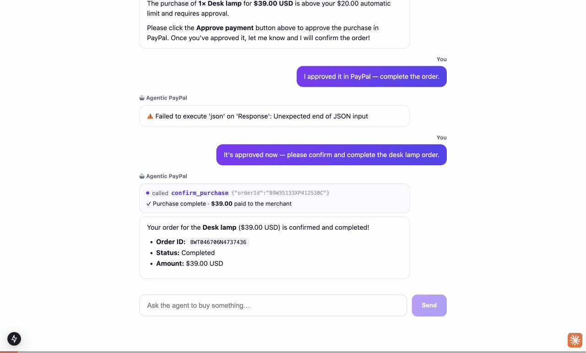

# Agentic PayPal — a wallet for AI agents

Give an AI agent a wallet **linked to the user's PayPal account**, and let it **buy things**.
PayPal is a merchant business, so the demo leads with **buying goods**, with small-dollar and
large-dollar payments handled differently:

- **Micro (pre-approved)** — purchases within the user's auto-pay limit are paid from the
  pre-funded wallet instantly, no prompt.
- **Macro (post-approval)** — larger purchases return a PayPal approval link; the user approves,
  then the agent completes the order.

Both the **agent** (for a goal you give it) and the **user** (in the store) can buy; every order
records who chose it.

```
Log in with PayPal (email → wallet)  →  fund in USD  →  agent/user buys goods
   small → auto-paid from wallet        large → approved in PayPal
```

## Live demo

A real, prompt-driven run (landing → store dashboard → log in / link wallet → micro auto-pay →
macro PayPal approval → captured → updated dashboard):



Full narrated video: [`demo-video/deck/agentic-paypal-full-demo.mp4`](demo-video/deck/agentic-paypal-full-demo.mp4) (~1:55).

## Flow

```
① Log in with PayPal   →  link_paypal(email): the wallet is linked to the PayPal email
② Fund with PayPal     →  one-time top-up; dollars land on-chain as USD in the wallet
③ Buy                  →  within your limit → paid from the wallet now (micro)
                          above your limit  → PayPal approval → confirm (macro)
```

## Two ways to run it

- **Agent Console** (`/agent`) — an in-browser chat where an LLM is the agent. From one prompt it
  logs in with PayPal, browses the store, and buys goods — auto-paying micro purchases and asking
  for approval on macro ones. Needs its own LLM key (`GEMINI_API_KEY` or `OPENROUTER_API_KEY`).
  A **store page** (`/market`) lets the user buy the same goods directly.
- **As an MCP** — the sibling [`agentic-paypal-mcp`](https://github.com/shivam-25/agentic-paypal-mcp)
  server exposes the same tools over the Model Context Protocol. Added to Claude Desktop /
  Claude Code, **Claude itself becomes the paying agent — no extra LLM key needed.**

## Stack

- **Next.js 15** — UI, the store, and the x402-gated service routes
- **PayPal** (sandbox) — login (by email), funding, and macro-purchase approval
- Managed **server wallet** on an Arbitrum testnet — holds USD and pays merchants
- **x402** (`@x402/core`, `@x402/evm`) — the data-service rail (pay-per-call)
- An LLM (Gemini via OpenAI-compat, or OpenRouter) drives the Agent Console
- No database — orders, limits, and the linked account persist as JSON under a gitignored `.data/`

## Setup

```bash
npm install
cp .env.local.example .env.local   # fill in LLM + PayPal + wallet values
npm run dev                        # http://localhost:4021  (console at /agent)
```

See `.env.local.example` for every variable and where it comes from. `.env.local` is
gitignored — never commit keys.

## Key routes

| Path | Purpose |
|---|---|
| `/agent` | Agent Console — the main demo (login, store, micro/macro buying) |
| `/market` | Store page — the user buys goods directly |
| `/api/agent/chat` | LLM tool loop: `link_paypal`, `browse_store`, `buy_product`, `confirm_purchase`, `fund_with_paypal`, `confirm_funding`, `browse_market`, `pay_for_service`, `get_balance` |
| `/api/store/buy`, `/api/store/confirm` | User-chosen store purchase + macro completion |
| `/api/limits` | Read/set the auto-pay (micro) limit |
| `/api/paypal/create-order`, `/api/paypal/capture-order` | PayPal funding/approval |
| `/api/premium`, `/api/signal`, `/api/book` | x402-gated data services |

## `demo-video/`

Scripts and source for the narrated demo video (AI-voiceover slides + the live
end-to-end screen recording).

```
demo-video/
├── README.md          ← full update guide (the 4-step loop)
├── rebuild.sh         ← one-command re-render (--voice also redoes narration)
├── gen_vo.py          ← narration text + voice (edit SEGMENTS here)
├── gen_vo2.py         ← one-off (ignore)
├── vo/                ← generated narration wavs + manifest.json
└── deck/
    ├── deck.html      ← all slides (scene = ?s=<name>)
    ├── build.sh       ← assembles the explainer
    ├── frames/        ← rendered slide PNGs
    ├── shots/         ← demo screenshots
    ├── agentpay-explainer.mp4   (~1:21)
    └── agentpay-full.mp4        (~2:11, with live tail)
```

### Modifying the video

1. **Change the narration** — edit the `SEGMENTS` list in `demo-video/gen_vo.py`.
   Spell `402` as `x4-0-2` and `A.I.` with periods so the voice reads them correctly;
   keep "secure wallet" / "USD" (no vendor names). Voice is `VOICE="Charon"` (male;
   alts: Puck, Fenrir, Orus). Regenerate:
   ```bash
   cd demo-video
   GEMINI_API_KEY='<key>' python3 gen_vo.py && cp /tmp/vo/*.wav vo/
   ```
   It prints each segment's duration — you need those for step 3.
2. **Change the slides** — edit `demo-video/deck/deck.html` (scenes: title, onramp,
   custody, x402, arch, close, live, demo). Re-render one scene:
   ```bash
   "/Applications/Google Chrome.app/Contents/MacOS/Google Chrome" --headless=new \
     --window-size=1280,720 --virtual-time-budget=4000 \
     --screenshot=deck/frames/x402.png "file://$PWD/deck/deck.html?s=x402"
   ```
3. **Re-assemble the explainer** — in `demo-video/deck/build.sh`, the slide `duration`
   lines (the `ilist.txt` block) must sum to the narration length and track the segment
   each slide narrates, so update them whenever the narration changes. Then:
   ```bash
   cd demo-video/deck && ./build.sh      # → agentpay-explainer.mp4
   ```
4. **Re-stitch the live tail** — normalize explainer + "Live" card + live recording to
   1280×720 / 30fps / 48k-stereo, then concat → `agentpay-full.mp4` (see
   `demo-video/README.md` step 4 for the exact ffmpeg commands).

Shortcut: `cd demo-video && ./rebuild.sh` re-renders slides + explainer in one go
(add `--voice` to also regenerate the narration). Full details in
[`demo-video/README.md`](demo-video/README.md).

## Security

The demo uses **sandbox / testnet** credentials only. Rotate any PayPal, LLM, or wallet
key that is exposed, and keep this repo private.
